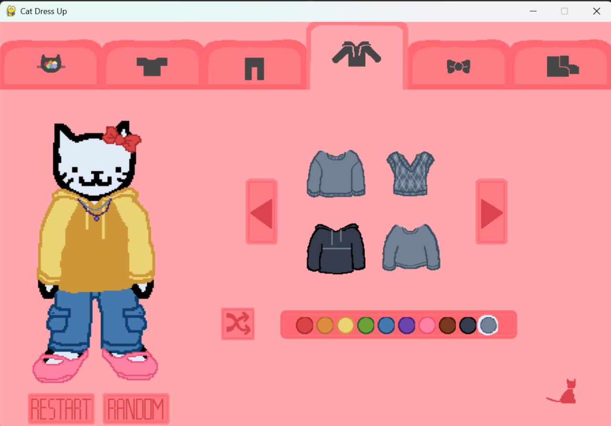

# Dress Up Cat 

## Description

  
  This independent project was inspired by my childhood love of cats and dress-up flash games. All game assets are original pixel art and were designed and drawn by me for this project.

## Technologies

- Python
- Pygame Library
- VS Code

## Running the Program

### 1.) Install Pygame

Ensure Python is installed before attempting to install Pygame

windows:    
  &emsp;copy/paste in the terminal to install: pip install pygame   
  &emsp;copy/paste in the terminal to check if it's working. A minigame should run: python -m pygame.examples.aliens
    
Mac:    
  &emsp;copy/paste in the terminal to install: pip install pygame: python3 -m pip install pygame   
  &emsp;copy/paste in the terminal to check if it's working. A minigame should run: python3 -m pygame.examples.aliens
    
If any problems occur, visit the [Pygame GitHub](https://github.com/pygame/pygame) for more information.

### 2.) Run main.py in your IDE or through the terminal
   
## Project Status: Completed

> Completed:
> * Game state manager to control different tabs of selections 
> * Item selection carousels 
> * Randomize outfit button
> * Reset button
> * Clothing appearing on the character (in the correct order)
> * Pixel art assets

